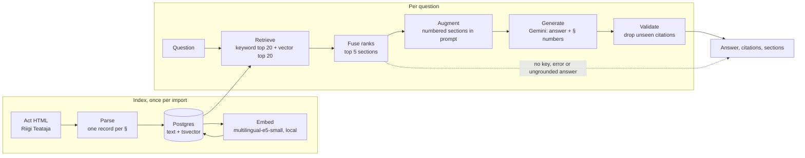
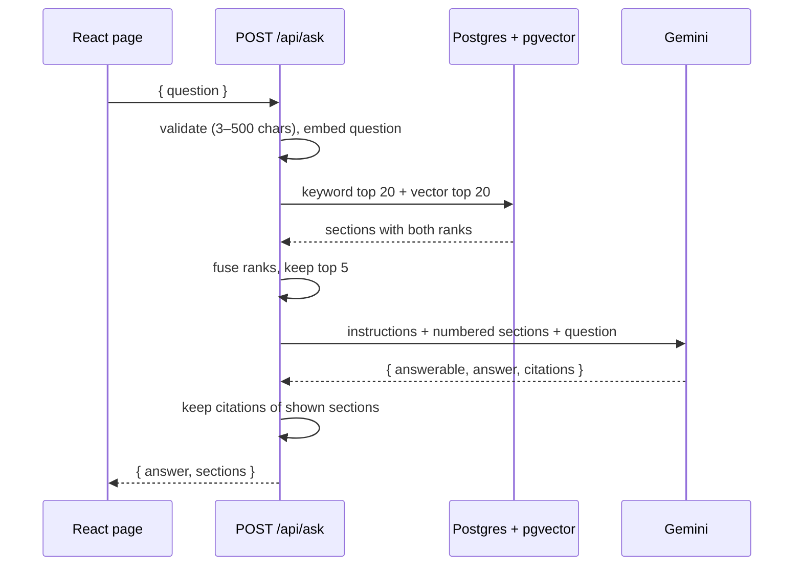

# Architecture

A question goes in; a short answer with § citations and the sections it came from come out. The model only ever
sees sections the app retrieved, and the app checks every citation it returns.

## The pipeline

## Step by step

### 0. Index: turning the act into searchable sections

| What | Where |
|---|---|
| Download the HTML (or read a saved file) | `scripts/import-act.ts` |
| Split it into sections | `services/act-parser.ts` |
| Store them, replacing the previous import | `services/act-import.ts`, `repositories/law-section-repository.ts` |
| Embed each section | `scripts/embed-sections.ts`, `services/embedding.ts`, `services/passage.ts` |

- **One chunk per §.** A section is the unit the law itself uses and the unit people cite, so it is the natural
  chunk. Fixed-size chunks would cut subsections in half and make citations meaningless.
- **A header on each embedded passage.** The text embedded is `Employment Contracts Act § 97. Terms for advance
  notice of cancellation by employer` followed by the section. Section text often says "this section" or refers to
  subsections by number, so without the header many sections look alike to the embedding model.
- **Superscript section numbers.** The act has both § 10¹ (Probationary period) and § 101 (a different section).
  The HTML writes the first as `101`, so the parser turns `` digits into superscript characters
  before removing tags. The import refuses an act with a repeated § number, which is what a parsing mistake here
  would produce.
- **Noise removed.** The parser reads Riigi Teataja's markup, not just its text. Hover-menu buttons ("history",
  "link"), the table of amending acts, chapter and subchapter headings, amendment notes
  (`[RT I, 30.04.2022, 1 – entry into force …]`, which wrap over lines), footnotes, repealed subsections and
  repealed or omitted sections are dropped. They match many keyword searches but answer nothing. The parser was
  first written from a description of the page and was wrong in all of these ways; `tests/fixtures/` now holds
  real excerpts that the parser tests run against.
- **A local multilingual embedding model.** `multilingual-e5-small` runs in Node with no API key, and a question
  asked in Estonian still finds the English text. e5 models expect `query: ` and `passage: ` prefixes.

### 1. Retrieve: finding the right sections

| What | Where |
|---|---|
| Embed the question, run both searches in one SQL query | `services/retriever.ts`, `repositories/law-section-repository.ts` |
| Merge the two ranked lists | `services/ranking.ts` |

- **Two searches, because each misses what the other finds.** Keyword search (Postgres full text) is good at exact
  terms such as "probationary period" or "overtime". Vector search finds sections that mean the same thing in
  different words ("fired" and "cancellation of employment contract").
- **Words ORed, not ANDed.** `plainto_tsquery` requires every word of the question to appear, which a whole
  sentence almost never satisfies. The query joins the words with OR and lets `ts_rank` favour sections that
  match more of them.
- **Reciprocal rank fusion.** Each section scores `1 / (60 + rank)` in each list it appears in, and the scores are
  added. Only ranks are used, so the two searches' scores, which aren't comparable, never get mixed. A section
  found by both searches beats one found by only one.
- **Fusion in code, not SQL.** The query returns both ranks for every section found. The app fuses them, and the
  evals rank the same rows keyword-only, vector-only and hybrid, to show what each search adds.

### 2. Augment: building the prompt

`services/answer-prompt.ts` writes the instructions, then each of the 5 sections as `[§ 97] Title` followed by its
text, then the question. The labels are what the model cites. The instructions (in `constants/rag.ts`) tell it to
use only these sections, to answer in plain English, and to say so when the sections don't cover the question.

### 3. Generate and validate: the answer

| What | Where |
|---|---|
| Call Gemini with a JSON schema | `services/gemini-client.ts` |
| Check the reply and its citations | `services/answer-generator.ts` |

- **Structured output.** Gemini must return `{ answerable, answer, citations }` matching a JSON schema, so the app
  reads citations as data instead of parsing them out of prose.
- **Citations are checked, not trusted.** A citation of a section the model wasn't shown is dropped. An answer
  marked answerable but left with no valid citation isn't grounded in the act, so it is rejected (returned as no
  answer) rather than shown.
- **Fails safe.** No key, a timeout, an error status or a malformed reply all give `answer: null`. The 5 retrieved
  sections are still returned.
- **No call when nothing was retrieved.** With no sections there is nothing to ground an answer in, so the app
  refuses without asking the model.

## Request flow

## Files

| File | Responsibility |
|---|---|
| `server.ts` | Runs migrations, connects the ORM, wires the pipeline, serves the API and the built frontend. |
| `app.ts` | Builds the Fastify app around an `Ask` function, so tests can pass a fake one. |
| `routes/ask-route.ts` | `POST /api/ask`: validates the question and returns the pipeline's result. |
| `routes/web-route.ts` | Serves `web/dist` when it exists. |
| `services/ask-service.ts` | The pipeline for one question (retrieve, then answer), and the Gemini wiring. |
| `services/act-parser.ts` | Act HTML to one record per §. Pure. |
| `services/act-import.ts` | Parses an act, checks the result, replaces its stored sections. |
| `services/passage.ts` | The text embedded for a section: header plus body. Pure. |
| `services/embedding.ts` | Local e5 embeddings for questions and passages, loaded once. |
| `services/retriever.ts` | Embeds the question, runs the search, keeps the hybrid top 5. |
| `services/ranking.ts` | Reciprocal rank fusion, and keyword-only and vector-only ranking for the evals. Pure. |
| `services/answer-prompt.ts` | The augment step: instructions, numbered sections, question. Pure. |
| `services/answer-generator.ts` | The generate step: calls the model and validates its citations. |
| `services/gemini-client.ts` | POSTs a prompt and a JSON schema to Gemini and parses the JSON reply. No domain knowledge. |
| `repositories/law-section-repository.ts` | All database access: replace an act's sections, embeddings, the search SQL. |
| `models/law-section.ts` | MikroORM `EntitySchema` for `law_section`. |
| `db/` | ORM setup and Knex migrations (pgvector extension, generated tsvector column). |
| `constants/` | The act's URLs, tuned values, the prompt and schema, regexes, limits. |
| `types/` | Shared interfaces, with no runtime code. |
| `scripts/` | `import-act`, `embed-sections`, `migrate`. |
| `evals/` | Golden questions, metrics and the eval runner. |
| `web/src/` | React page: question form, answer panel, section list with each section's search ranks. |
| `tests/unit/` | Parser, ranking, answer validation, Gemini client, route, metrics, the browser's fetch. No Docker. |
| `tests/integration/` | Testcontainers (`pgvector/pgvector:pg16`): the import and the search SQL. |
